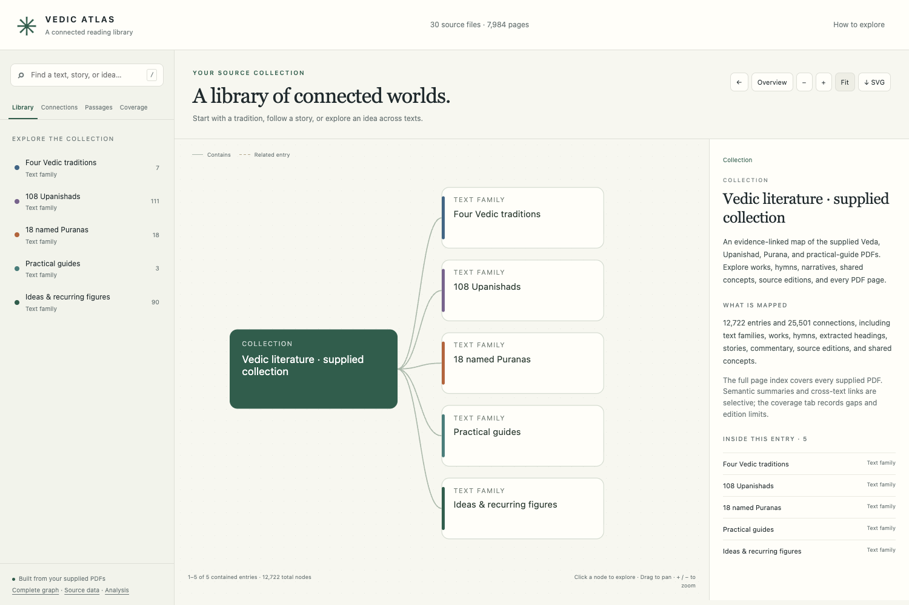

# Vedic Atlas

A connected reading library for exploring Vedas, Upanishads, Puranas, and the supplied practical guides.

**[Open the live atlas](https://sids40.github.io/vedic-atlas/)**

The atlas maps **30 source PDFs, 7,984 pages, 12,722 nodes, and 25,501 connections**. Browse text families and individual works, follow hymns and stories, compare recurring figures and ideas, search passages, and check the original PDF pages.



## Explore

- **Library:** navigate works, books, hymns, stories, chapters, commentary, and source editions.
- **Connections:** follow shared names, themes, narratives, and source-attested comparisons.
- **Passages:** search the extracted or recognized text of all supplied PDFs.
- **Coverage:** inspect partial editions, duplicate witnesses, commentary, OCR, and known gaps.

Use the map's zoom buttons, drag to pan, and select nodes to explore their immediate connections. Individual maps can be downloaded as SVG.

## Scope and evidence

Every supplied file and physical PDF page has a graph record. All 108 Upanishad catalog entries and all 1,028 Rigveda hymns are indexed. Story summaries and semantic links are selective; the collection includes abridged retellings, partial editions, and draft material.

Page references are one-based PDF pages. Shared wording or a shared figure does not establish identical doctrine or historical borrowing. OCR may misread names, numbers, and accents; use the original PDF to verify a passage.

- [Analysis and source audit](analysis/REPORT.md)
- [Validation record](analysis/validation.json)
- [Browser checks](analysis/browser-validation.json)
- [Complete graph — GraphML](output/atlas.graphml)
- [Complete graph — JSON](output/atlas.json)
- [Editable overview board](https://www.tldraw.com/f/dqkvNcwdrQ3GX4MkrPqRB)

## Run locally

Clone or download this repository and open `index.html`. All application assets and reading text are included; there is no installation or build step. Keep the directory structure and source filenames unchanged so PDF links continue to work.

Alternatively, serve the repository root:

```sh
python3 -m http.server 8000
```

Then open `http://localhost:8000/`.

## Project files

- `output/`: browser application, reading text, graph exports, and preview images.
- `inputs/`: the supplied source PDFs, with their original filenames.
- `analysis/`: structured annotations, collection notes, and validation records.
- `scripts/`: extraction, local OCR, indexing, graph assembly, and report generation.
- `corpus/manifest.json`: source inventory and SHA-256 hashes. Intermediate extracted text and OCR files are excluded from version control.

The application runs entirely in the browser without external APIs, accounts, or analytics. GitHub Pages serves the checked-in static files from `main` at the repository root; `.nojekyll` preserves the existing filenames and folder structure.

## Rebuild the data

The published app is ready to use. Rebuilding its data requires Python 3 and Poppler's `pdftotext` and `pdfinfo`. Put them on `PATH`, or set `POPPLER_BIN` to their directory.

1. Run `python3 scripts/extract_corpus.py`.
2. On macOS, compile the scan recognizer with `swiftc scripts/ocr_pdf.swift -o scripts/ocr_pdf`, then run `python3 scripts/run_ocr.py`. It uses Apple's PDFKit and Vision frameworks.
3. Review or edit the retained annotation files in `analysis/`, then run `python3 scripts/build_atlas.py` and `python3 scripts/write_report.py`.

Running extraction replaces the intermediate corpus and manifest. Preserve or regenerate recognized text before assembling the graph. Collection analyzers are provided as indexing aids; rerunning them can replace reviewed annotations.

Source editions and translations retain their own attribution and rights notices. Their inclusion does not imply a blanket license for all materials in this collection.
